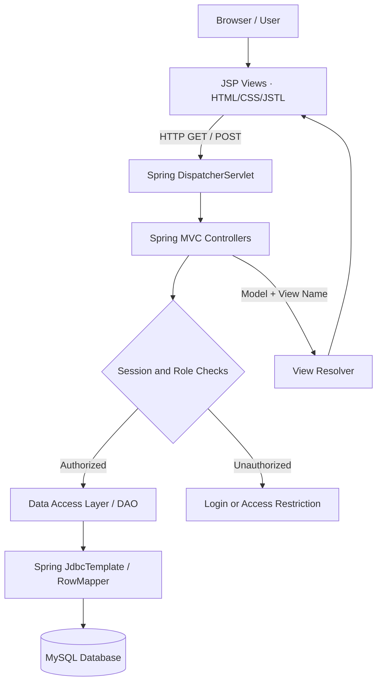
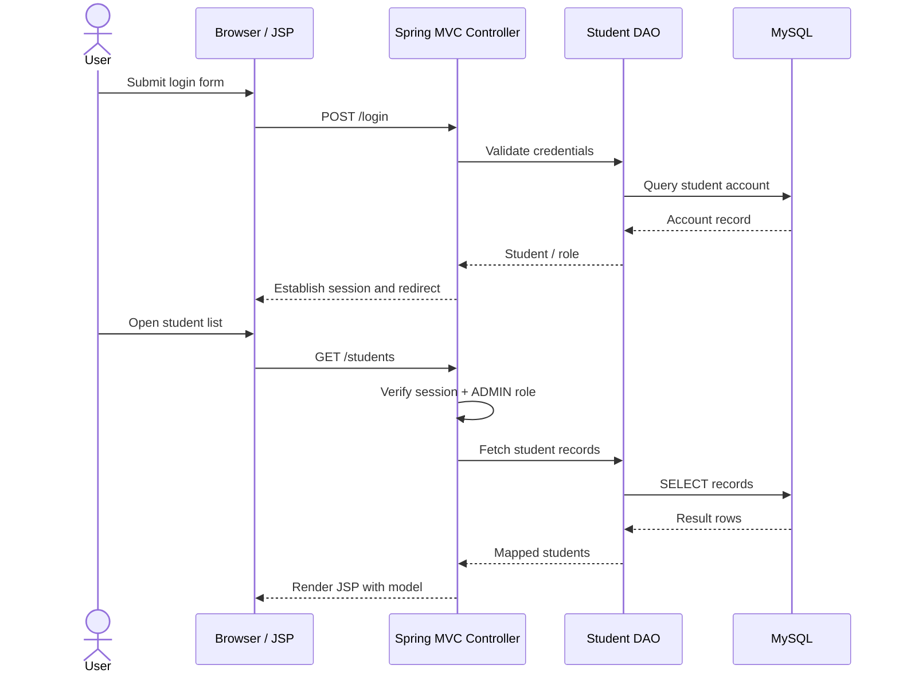
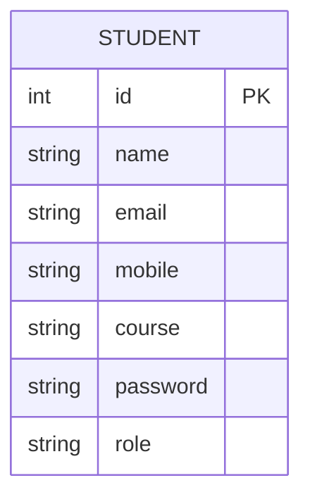

# 🎓 Student Portal — Spring MVC Web Application

A role-based student management web application built with **Java, Spring MVC, Spring JDBC, JSP/JSTL, and MySQL**. The project demonstrates traditional server-side MVC architecture, session-based authentication, authorization checks, and database-backed CRUD operations.

> **Architecture:** Layered MVC web application deployed as a WAR to a Jakarta Servlet container. This is a Spring MVC project, **not Spring Boot**.

## 🏗️ System Architecture



### Architecture responsibilities

| Layer | Technology | Responsibility |
|---|---|---|
| Presentation | JSP, JSTL, HTML, CSS | Render forms, student records, login and profile pages |
| Web / Controller | Spring Web MVC | Handle routes, form submissions, session checks and view selection |
| Domain Model | Java POJOs | Represent student information and roles |
| Persistence | Spring JDBC, `JdbcTemplate`, `RowMapper` | Execute parameterized SQL and map database rows |
| Database | MySQL | Persist student accounts and academic information |
| Runtime | Jakarta Servlet container, Maven WAR | Serve the application |

## ✨ Features

- Student login and session-based access.
- Role-based access for **ADMIN** and **STUDENT** users.
- **ADMIN:** view students, add records, edit records and delete records.
- **STUDENT:** access their own profile.
- MVC-based separation of controllers, views, models and database operations.
- MySQL persistence through Spring JDBC.
- Session logout and restricted-page navigation.

## 🔐 Role-Based Access

| Operation | ADMIN | STUDENT |
|---|:---:|:---:|
| Login | ✅ | ✅ |
| View own profile | ✅* | ✅ |
| View student list | ✅ | ❌ |
| Add student | ✅ | ❌ |
| Edit student | ✅ | ❌ |
| Delete student | ✅ | ❌ |

*Profile behavior depends on the logged-in account and the project's controller rules. The project also includes a rule preventing an administrator from deleting their own account.

> **Security note:** Authorization here is implemented through application-level session/role checks. Do not confuse this with a Spring Security integration or JWT authentication.

## 🔄 Request Lifecycle



## 🧩 Main MVC Routes

| Method | Route | Purpose |
|---|---|---|
| GET | `/login` | Display login page |
| POST | `/login` | Authenticate account |
| GET | `/students` | List student records (admin) |
| GET | `/addStudent` | Display add form |
| POST | `/addStudent` | Create student |
| GET | `/editStudent` | Load student for editing |
| POST | `/updateStudent` | Update student |
| GET/POST | `/deleteStudent` | Delete student (check controller mapping) |
| GET | `/profile` | Show logged-in student profile |

> Route method details should be checked against the controller annotations before deployment; this table documents the intended MVC workflow.

## 🗄️ Data Model

The student model used in this project contains fields similar to:

| Field | Purpose |
|---|---|
| `id` | Student identifier |
| `name` | Student name |
| `email` | Account email |
| `mobile` | Contact number |
| `course` | Course information |
| `password` | Login credential |
| `role` | `ADMIN` or `STUDENT` |



*This is a conceptual model, not a verified SQL migration or physical schema.*

## 🛠️ Technology Stack

| Component | Stack |
|---|---|
| Language | Java |
| MVC Framework | Spring Web MVC 7.0.8 |
| Database access | Spring JDBC 7.0.8 |
| Database | MySQL + Connector/J 9.4.0 |
| Server-side views | JSP 4.0, JSTL 3.x |
| Servlet API | Jakarta Servlet 6.1 |
| Build | Apache Maven |
| Artifact | WAR (`Student_portal.war`) |

Dependency versions are taken from the repository's `pom.xml`.

## 📂 Code Organization

```text
Student_portal/
├── pom.xml
├── .gitignore
└── src/
    └── main/
        ├── java/               # Java source: MVC controllers, models, DAO/config
        └── webapp/             # JSP views and web resources
```

The tree above shows a **logical overview**, not an exhaustive listing of every package or source file. Consult the repository for exact package names.

## 🚀 Local Setup

**Prerequisites:** compatible JDK for Spring Framework 7, Maven, MySQL, and a compatible Jakarta Servlet/JSP container (such as Tomcat 11).

1. Clone the repository:

   ```bash
   git clone https://github.com/VikramKumar-java/Student_portal.git
   cd Student_portal
   ```

2. Create the required MySQL database and schema according to the SQL queries used by the DAO. Configure the local JDBC URL, username and password in the project's data-source configuration.
3. Build the application:

   ```bash
   mvn clean package
   ```

4. Deploy the generated `target/Student_portal.war` to a compatible Tomcat server.
5. Open:

   ```text
   http://localhost:8080/Student_portal/
   ```

   Navigate to `/login` if the application has no root-page mapping.

> **Configuration:** Do not commit real database passwords or other secrets. The repository should document its actual database schema and configurable connection properties for reproducible setup.

## 🧪 Suggested Validation Checklist

- [ ] Login succeeds for a valid account.
- [ ] Invalid credentials are rejected.
- [ ] Unauthenticated users cannot access restricted pages.
- [ ] Students cannot access admin-only routes.
- [ ] Admin can create, read, update and delete permitted records.
- [ ] A student sees only their own profile.
- [ ] Admin self-deletion is blocked.
- [ ] Logout invalidates the session.
- [ ] Form inputs and database errors are handled safely.

## 📈 Possible Improvements

- Replace custom authentication with Spring Security and securely hashed passwords.
- Add server-side validation and consistent exception handling.
- Introduce a dedicated service layer as business logic grows.
- Add automated unit/integration tests.
- Add schema migrations with Flyway or Liquibase.
- Use environment-based database configuration and CI checks.

## 👨‍💻 Author

**Vikram Kumar**  
[GitHub](https://github.com/VikramKumar-java) · [LinkedIn](https://www.linkedin.com/in/vikram-kumar-sangishetti-404ab42aa/)

---

**Project repository:** https://github.com/VikramKumar-java/Student_portal
